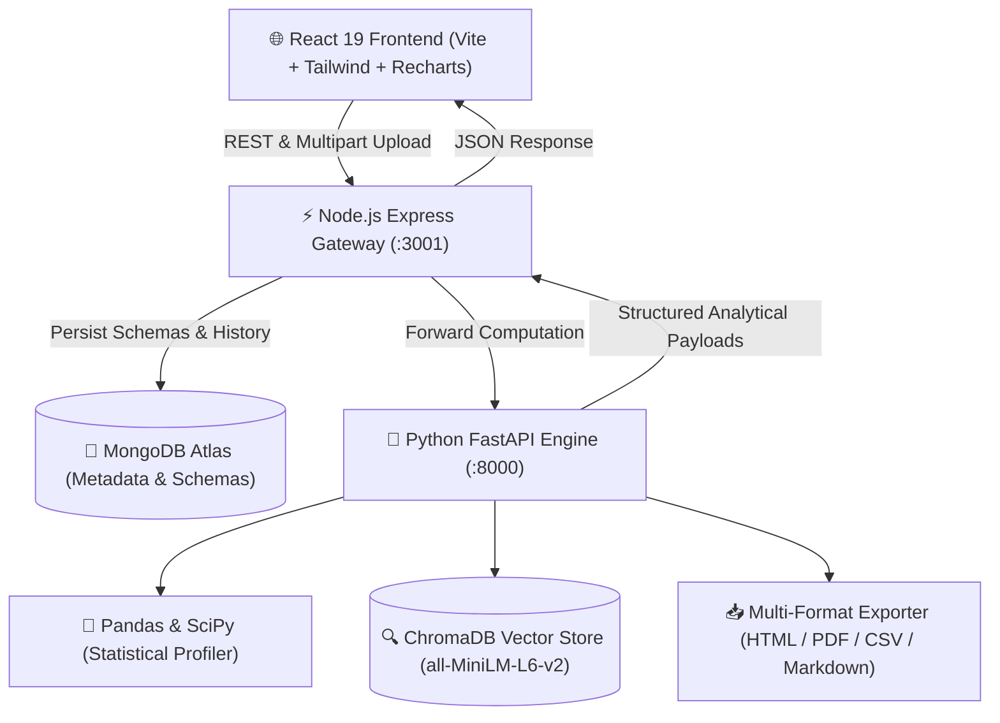

# 🚀 AI Data Analytics Copilot — Version 1 Enterprise Edition

<div align="center">


**An autonomous full-stack platform that transforms raw datasets into presentation-grade intelligence, automated cleaning recipes, semantic Q&A, and Power BI-grade interactive reports.**

[Quick Start](#-quick-start) • [Architecture](#-system-architecture) • [Key Capabilities](#-phase-by-phase-capabilities) • [API Reference](#-api-reference) • [CI/CD Smoke Testing](#-end-to-end-smoke-testing)

</div>

---

## 💡 Executive Summary

**AI Data Analytics Copilot** bridges the gap between raw, messy data files and executive decision-making. Built on modern full-stack MERN + Python FastAPI microservices architecture, it enables users to upload CSV or Excel files, automatically audit schema hygiene, apply non-destructive data cleaning, run exploratory data analysis (EDA), chat semantically with their data via vector embeddings (RAG), and design **Power BI-grade visual reports** with multi-format offline downloads.

### 🛡️ Core Engineering Principle: Zero Hallucination
> **The platform strictly distinguishes mathematical facts from AI narratives:**
> 1. **Calculated Facts:** All aggregations, IQR bounds, Pearson correlations, and distributions are computed directly in Python with Pandas/NumPy.
> 2. **AI Explanations:** Natural-language contextual synthesis grounded only in verified facts.
> 3. **Actionable Recommendations:** Prioritized business roadmaps tied to observed variance.

---

## 🏛️ System Architecture



---

## ✨ Phase-by-Phase Capabilities

| Phase | Milestone | Capabilities & Engineering Highlights |
| :---: | :--- | :--- |
| **1** | **Monorepo & Discovery** | Monorepo structure with pnpm workspaces, decoupled Node API and Python FastAPI services with mutual health discovery. |
| **2** | **Dataset Ingestion** | Multipart ingestion (CSV, XLSX) up to 50MB, UUID disk collision prevention, row/column/missing stats, and Atlas schema storage. |
| **3** | **Automated Profiling** | Pandas type inference, IQR outlier fences ($1.5 \times \text{IQR}$), skewness, and 100-point Data Hygiene Index. |
| **4** | **Data Cleaning Studio** | Non-destructive cleaning recipes: Mean/Median/Mode imputation, deduplication, IQR capping, and clean CSV export. |
| **5** | **Automated EDA Studio** | Dynamic multi-dimensional aggregations, correlation heatmaps, Recharts custom visualizer (Bar, Line, Area, Donut). |
| **6** | **Semantic RAG Copilot** | ChromaDB vector indexing with sentence-transformers (`all-MiniLM-L6-v2`), conversational advisory engine with zero LLM calculation errors. |
| **7** | **Power BI Report Studio** | Interactive canvas with KPI tiles, Recharts segment visuals, live dimensional slicers, report designer modal, and standalone offline HTML/PDF/CSV export. |
| **8** | **System Hardening** | Session state persistence (`localStorage`), global toast notifications, dataset purge cascading to vector stores, and automated E2E smoke tests. |
| **9** | **Containerization** | Production Dockerfiles for all microservices, multi-stage builds, and unified `docker-compose.yml` deployment. |

---

## 🚀 Quick Start

### Option A: One-Click Docker Compose (Recommended)

```bash
# Clone the repository
git clone https://github.com/Rajnish-rj07/AI-Data-Analytics-RAG-Copilot.git
cd AI_DA_COPILOT

# Launch all microservices (Mongo, FastAPI, Node API, React Nginx)
docker compose up --build
```
- **Web Dashboard:** `http://localhost:80`
- **Node.js Gateway:** `http://localhost:3001`
- **Python AI Engine:** `http://localhost:8000`

---

### Option B: Local Native Development

#### 1. Prerequisites
- **Node.js:** $\ge 18$
- **Python:** $\ge 3.11$
- **pnpm:** $\ge 8$ (`npm install -g pnpm`)
- **MongoDB:** Local or free MongoDB Atlas URI

#### 2. Install Dependencies
```bash
# Install Node.js workspace dependencies
pnpm install

# Set up Python Virtual Environment
cd services/ai
python -m venv venv

# Windows:
venv\Scripts\activate
# macOS/Linux:
source venv/bin/activate

pip install -r requirements.txt
cd ../..
```

#### 3. Run Microservices
Open three terminal windows:

```bash
# Terminal 1 — Python FastAPI Engine
cd services/ai
.\venv\Scripts\uvicorn.exe app.main:app --host 127.0.0.1 --port 8000 --reload

# Terminal 2 — Node.js Express Gateway
cd apps/api
node --watch src/app.js

# Terminal 3 — React Vite Frontend
pnpm --filter web dev
```
Visit `http://localhost:5173` in your browser.

---

## 🧪 End-to-End Smoke Testing

Run the automated CI/CD validation script to verify all 8 phases across both services in seconds:

```bash
node scripts/test_pipeline.js
```

**Test Verification Output:**
```text
══════════════════════════════════════════════════════════════
  Phase 1: Cluster Health & Service Discovery
✔ [Phase 1] Node API, MongoDB, and AI service healthy
  Phase 2: Multi-Format Dataset Ingestion
✔ [Phase 2] Dataset uploaded & schema inferred (9 columns, 17 rows)
  Phase 3: Deep Statistical Profiling & Outlier Bounds
✔ [Phase 3] Profile calculated with hygiene score: 90/100
  Phase 4: Smart Data Cleaning Pipeline
✔ [Phase 4] Cleaning applied successfully
  Phase 5: Automated EDA Studio & Smart Aggregations
✔ [Phase 5] Dynamic aggregation computed for category groupings
  Phase 6: Semantic RAG Analytics via ChromaDB
✔ [Phase 6] ChromaDB vector index queried with semantic grounding
  Phase 7: Power BI Integrated BI Report Studio
✔ [Phase 7] Multi-row KPI tiles & Recharts visual payloads generated
  Phase 8: System Hardening & Clean Storage Purge
✔ [Phase 8] Dataset and associated ChromaDB collections purged cleanly!
══════════════════════════════════════════════════════════════
  🎉 ALL 8 PHASES PASSED WITH ZERO ERRORS!
══════════════════════════════════════════════════════════════
```

---

## 📡 API Reference

### Dataset Management
- `POST /api/v1/datasets` — Ingest CSV/Excel file, parse schema, compute statistics.
- `GET /api/v1/datasets` — List saved dataset metadata.
- `GET /api/v1/datasets/:id` — Retrieve full dataset schema and preview rows.
- `DELETE /api/v1/datasets/:id` — Purge dataset from MongoDB, disk storage, and ChromaDB vector store.

### Statistical & EDA Endpoints
- `GET /api/v1/datasets/:id/profile` — Deep profiling (correlation matrix, IQR boundaries, data hygiene score).
- `POST /api/v1/datasets/:id/clean` — Apply non-destructive cleaning recipe (imputation, deduplication, type casting).
- `GET /api/v1/datasets/:id/eda/summary` — Automated EDA findings and smart chart recommendations.
- `POST /api/v1/datasets/:id/eda/aggregate` — Multi-dimensional aggregation query for custom charts.

### Semantic RAG & BI Reporting
- `POST /api/v1/datasets/:id/rag/index` — Build/rebuild ChromaDB vector index.
- `GET /api/v1/datasets/:id/rag/status` — Get vector index readiness and collection status.
- `POST /api/v1/datasets/:id/rag/ask` — Semantic natural-language Q&A grounded in verified Pandas calculations.
- `POST /api/v1/datasets/:id/report` — Compile complete Power BI-grade report with Recharts visual payloads, KPI cards, and multi-format exports.

---

## 📄 License
This project is licensed under the MIT License.
Built with dedication by **Rajnish Kumar Maurya**.
